# Portfolio Optimizer

**Quantitative portfolio analytics and risk reporting.**
Šimon Havlík · 2026 · [optimizer.simonhavlik.com](https://optimizer.simonhavlik.com)

<p>
  
  
  
  
</p>

A Flask application that turns a portfolio, whether typed, exported as CSV or PDF, or supplied as a screenshot, into a full risk report: optimisation, tail-risk measurement, factor decomposition, stress testing and a written assessment. The public instance runs at the address above; the printable report is exported as a three-page PDF (fact sheet, appendix, charts).

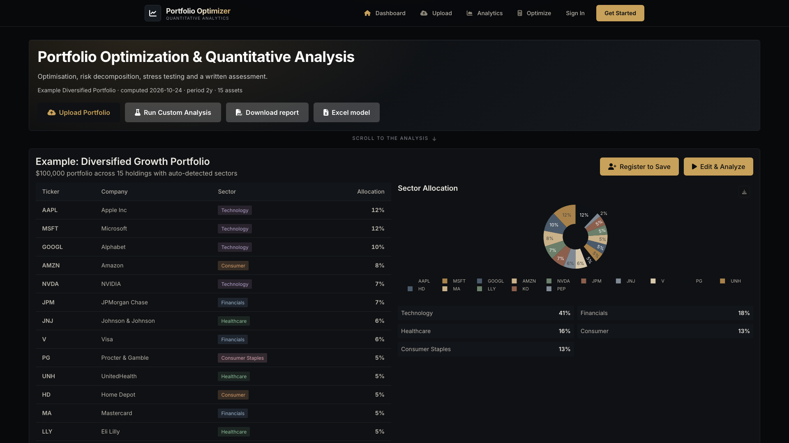

---

## 1. Overview

The application implements the classical portfolio workflow end to end:

1. **Intake** — holdings are recovered from broker documents or screenshots, validated, and mapped to tickers.
2. **Estimation** — daily returns over a two-year window are used for covariance and factor estimation.
3. **Analysis** — optimisation, risk decomposition, distributional diagnostics, stress scenarios and Monte Carlo simulation.
4. **Reporting** — an interactive dashboard, a two-page PDF fact sheet and per-chart PNG exports.

The design follows the mean–variance tradition (Markowitz, 1952; Sharpe, 1964), extended with tail-risk measurement and factor attribution.

---

## 2. Methodology

### 2.1 Optimisation

Four objective specifications are implemented: maximum Sharpe ratio, minimum variance, mean–variance with a target return, and risk parity. Covariance may be estimated with the sample estimator or Ledoit–Wolf shrinkage (Ledoit and Wolf, 2004). The Black–Litterman model (Black and Litterman, 1992) combines market equilibrium with explicit views, and hierarchical risk parity provides a clustering-based alternative.

### 2.2 Risk measurement

Risk is reported through:

- annualised volatility, downside deviation and beta;
- parametric and historical Value-at-Risk and Conditional Value-at-Risk at 95% and 99% (Rockafellar and Uryasev, 2000);
- maximum drawdown, average drawdown and drawdown duration;
- marginal and incremental Value-at-Risk contributions by position;
- Kelly and half-Kelly leverage, growth rate and the Calmar ratio.

### 2.3 Distributional diagnostics

Returns are tested for normality with the Jarque–Bera and Shapiro–Wilk statistics, for stationarity with the augmented Dickey–Fuller test, and for autocorrelation with the Ljung–Box statistic. Normal, Laplace and Student-t distributions are fitted by maximum likelihood and compared by AIC.

### 2.4 Factor and structural analysis

Fama–French three- and five-factor regressions (Fama and French, 1993, 2015) with momentum provide factor betas and alpha. Principal component analysis reports explained variance and loadings; rolling correlation and volatility describe the time-varying dependence structure.

### 2.5 Simulation and stress testing

Monte Carlo simulation generates five thousand one-year paths from the estimated mean vector and covariance matrix, reporting percentile bands and the probability of profit. Historical stress scenarios apply drawdowns from 2008, the 2020 crash, the dot-com period, a rate shock and a sector selloff.

### 2.6 Valuation and comparable companies

Owner earnings (trailing earnings yield, falling back to FCF/market cap) plus expected growth give an implied return per holding, aggregated at portfolio weight. That is compared with a CAPM cost of equity using the Damodaran implied equity risk premium, refreshed from his public workbook and cached for thirty days. A comparable-company sheet proposes peers with the model, validates every ticker against Yahoo Finance, and reports the peer median P/E, implied price and upside.

### 2.7 Reporting conventions

Daily returns are arithmetic and annualised by 252 trading days. VaR and CVaR are reported as positive loss magnitudes. Sharpe uses the configured risk-free rate; Sortino uses downside deviation. Beta and alpha are measured against the S&P 500. Generated commentary is checked numerically: any figure that cannot be traced to the supplied metrics is rejected and replaced by deterministic text built only from those metrics.

### 2.8 Text generation

Extraction and narrative commentary use a large language model (DeepSeek V4.1 Flash) with low reasoning effort. The model is constrained by a JSON schema for extraction and by an explicit editorial brief for commentary: quantified statements, no generic advice, no repeated disclaimers. Deterministic fallbacks and bounded retries limit failure modes.

---

## 3. Chart gallery

The figures below are the same images embedded in the PDF export. They are rendered server-side with Matplotlib, so the report is reproducible independently of the browser.

| | |
|---|---|
| 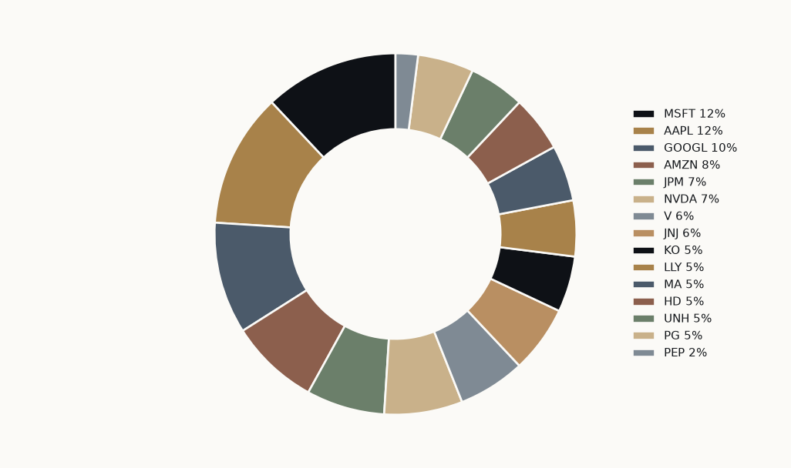 | 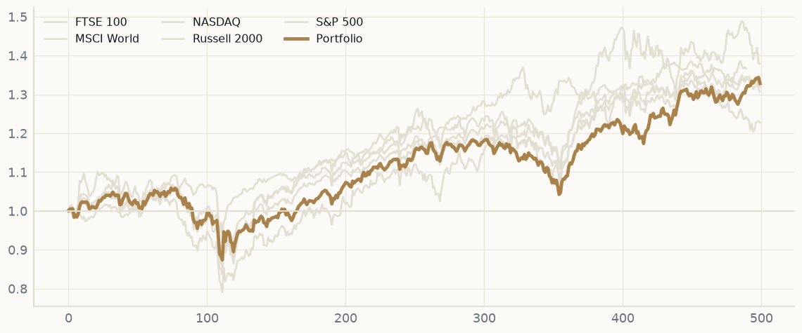 |
| *Figure 1.* Portfolio weights by holding. | *Figure 2.* Cumulative performance against benchmarks. |
| 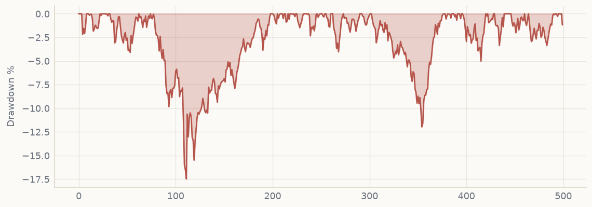 | 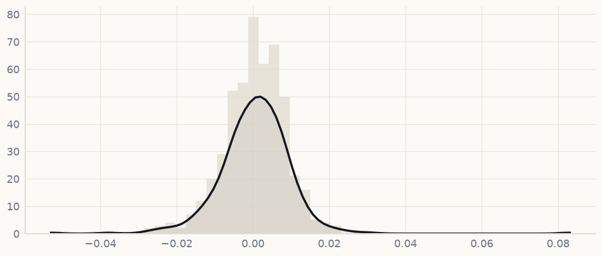 |
| *Figure 3.* Drawdown path from the running maximum. | *Figure 4.* Return distribution with fitted kernel density. |
| 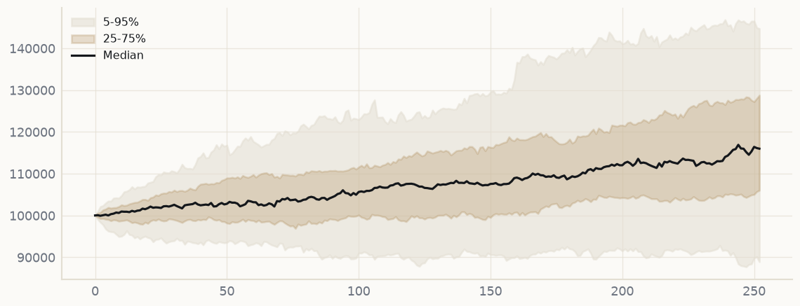 | 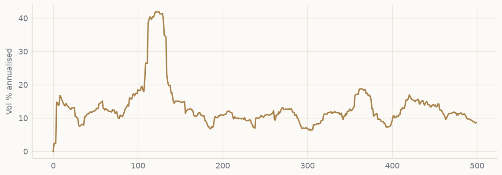 |
| *Figure 5.* Monte Carlo percentile bands, 5,000 paths. | *Figure 6.* Annualised rolling volatility. |
| 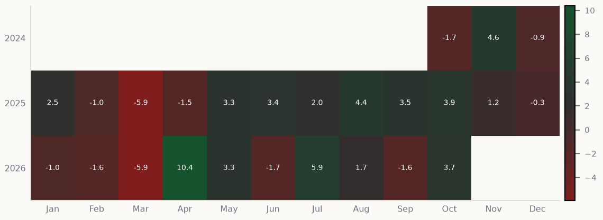 | 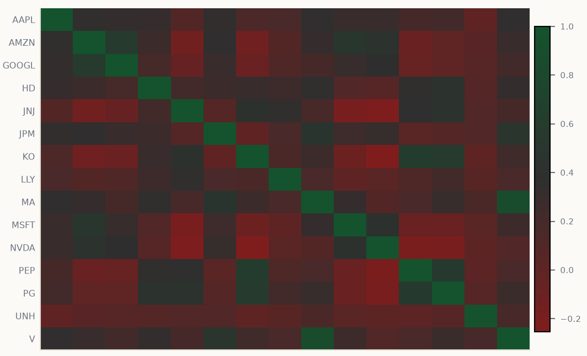 |
| *Figure 7.* Monthly returns by year. | *Figure 8.* Pairwise correlation of daily returns. |
| 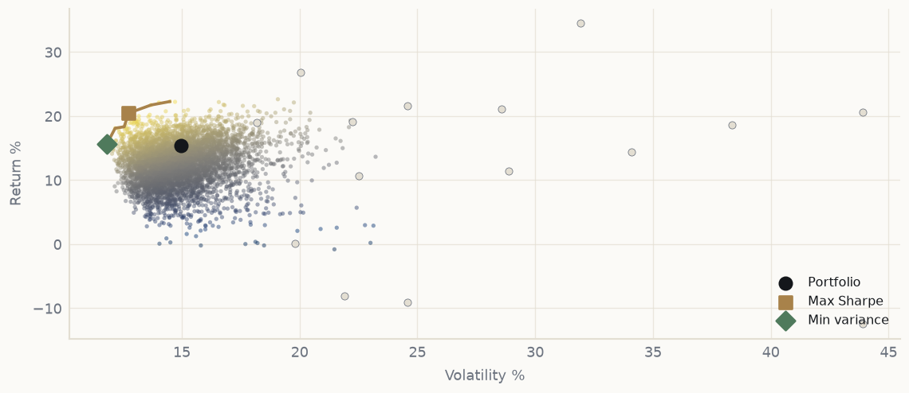 | 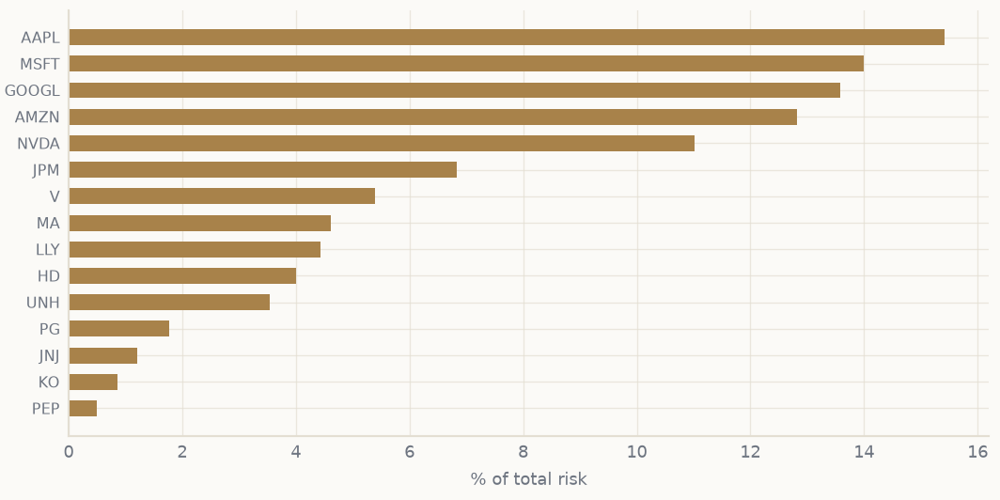 |
| *Figure 9.* Mean-variance frontier with the max-Sharpe and minimum-variance portfolios. | *Figure 10.* Contribution to total risk by position. |
| 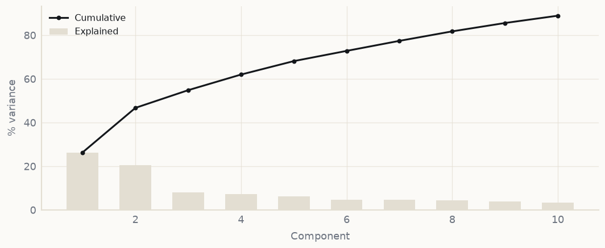 | 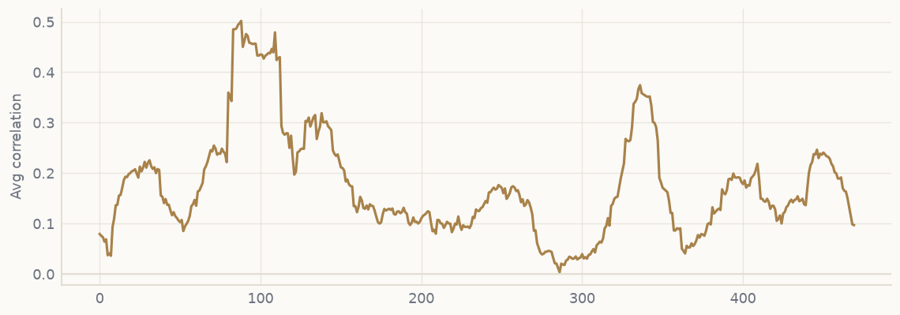 |
| *Figure 11.* Explained variance by principal component. | *Figure 12.* Average pairwise rolling correlation. |
| 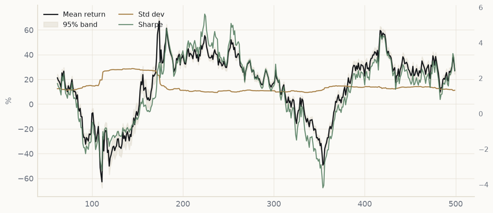 | |
| *Figure 13.* Rolling mean with 95% band, standard deviation and Sharpe ratio. | |

The complete three-page export is available as **[Portfolio-Optimizer-Report.pdf](docs/Portfolio-Optimizer-Report.pdf)**, and the workbook as **[portfolio-analysis-model.xlsx](docs/portfolio-analysis-model.xlsx)**.

---

## 4. Architecture

```
app.py                     application factory, routes and API
models/                    SQLAlchemy models (users, portfolios, holdings, cache)
routes/auth.py             registration, sessions, saved scenarios
services/                  market data, optimisation, risk, statistics, factors,
                           extraction, report rendering, email
templates/                 Jinja2 views (dashboard, upload, analysis, privacy, auth)
scripts/                   extraction accuracy harness, approval notices
docs/                      report charts, PDF export, screenshots
```

Persistence uses PostgreSQL in production and SQLite for local development. The example analysis is cached in the database and refreshed weekly, so restarts do not trigger recomputation.

---

## 5. Portfolio intake

Accepted formats: **CSV, XLSX, PDF, DOCX, PNG, JPG/JPEG, WEBP**. Text documents are parsed deterministically where possible; when the parser cannot recover holdings, or when the input is an image, the document is passed to the vision model. Extraction retries up to three times and fails loudly rather than returning partial holdings.

Accuracy is checked by `scripts/test_extraction.py`, which builds the same four-holding portfolio as DOCX, PDF, PNG and JPG and asserts tickers, company names, GICS sectors and weights:

```bash
PYTHONPATH=. python scripts/test_extraction.py
# docx=PASS, pdf=PASS, png=PASS, jpg=PASS, xlsx=PASS
```

---

## 6. Reporting

Each figure on the dashboard carries an export control that produces a 1600 × 900 PNG suitable for presentations and LinkedIn. The print path is a separate layout: a three-page A4 report: fact sheet on page one, appendix with calendar-year returns, drawdowns, correlations, monthly matrix, valuation sensitivity and comparables on page two, and thirteen charts on page three. A separate Excel workbook exports the same analysis with live formulas. Printing is triggered by **Download report**; the workbook is served by **Excel model**.

---

## 7. Reproducibility

```bash
python -m venv .venv && source .venv/bin/activate
pip install -r requirements.txt
export SECRET_KEY=dev
export LLM_API_KEY=...          # optional; AI features degrade gracefully
flask --app app run
```

Environment variables of interest: `DATABASE_URL`, `DB_TYPE`, `LLM_MODEL`, `SMTP_*`, `ADMIN_EMAIL`, `ENABLE_AI_INSIGHTS`.

---

## 8. Privacy and limitations

Portfolio content is sent to the model provider for extraction and commentary; outside that inference step data is not shared, and it is never sold. The policy is published at [/privacy](https://optimizer.simonhavlik.com/privacy).

This is a student project. It is not investment advice, the figures are not audited, and market data are supplied by Yahoo Finance without warranty. Past performance is not indicative of future results.

---

## 9. References

Black, F. and Litterman, R. (1992) 'Global portfolio optimization', *Financial Analysts Journal*, 48(5), pp. 28–43.

Fama, E.F. and French, K.R. (1993) 'Common risk factors in the returns on stocks and bonds', *Journal of Financial Economics*, 33(1), pp. 3–56.

Fama, E.F. and French, K.R. (2015) 'A five-factor asset pricing model', *Journal of Financial Economics*, 116(1), pp. 1–22.

Jorion, P. (2007) *Value at Risk: The New Benchmark for Managing Financial Risk*. 3rd edn. New York: McGraw-Hill.

Ledoit, O. and Wolf, M. (2004) 'Honey, I shrunk the sample covariance matrix', *The Journal of Portfolio Management*, 30(4), pp. 110–119.

Markowitz, H. (1952) 'Portfolio selection', *The Journal of Finance*, 7(1), pp. 77–91.

Rockafellar, R.T. and Uryasev, S. (2000) 'Optimization of conditional value-at-risk', *Journal of Risk*, 2(3), pp. 21–41.

Damodaran, A. (2026) *Implied Equity Risk Premiums*. New York: Stern School of Business. Available at: https://pages.stern.nyu.edu/~adamodar/ (Accessed: 24 October 2026).

Sharpe, W.F. (1964) 'Capital asset prices: a theory of market equilibrium under conditions of risk', *The Journal of Finance*, 19(3), pp. 425–442.

---

© 2026 Šimon Havlík. Source available for reference and review.
