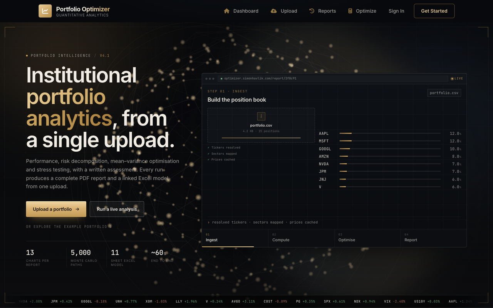
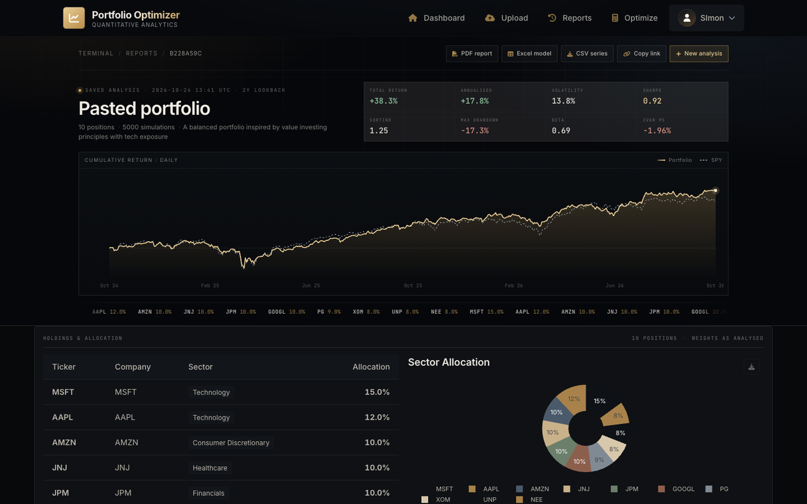

# Portfolio Optimizer

**Institutional-grade portfolio analytics from a single upload.**
Šimon Havlík · 2026 · [optimizer.simonhavlik.com](https://optimizer.simonhavlik.com)

<p>
  
  
  
  
  
</p>

A Flask application that turns a portfolio — typed, exported as CSV or PDF, or supplied as a
screenshot — into a complete risk report: mean–variance optimisation, tail-risk measurement,
factor decomposition, stress testing, valuation and a written assessment. The public instance
runs at the address above; the same analysis is available as an interactive terminal view, a
three-page A4 PDF and a thirteen-sheet Excel workbook.



---

## Contents

1. [Overview](#1-overview)
2. [Interface](#2-interface)
3. [Methodology](#3-methodology)
4. [Chart gallery](#4-chart-gallery)
5. [Architecture](#5-architecture)
6. [Portfolio intake](#6-portfolio-intake)
7. [Reporting and exports](#7-reporting-and-exports)
8. [Analysis parameters](#8-analysis-parameters)
9. [Reproducibility](#9-reproducibility)
10. [Data sources and limitations](#10-data-sources-and-limitations)
11. [Roadmap](#11-roadmap)
12. [References](#12-references)

---

## 1. Overview

The application implements the classical portfolio workflow end to end:

1. **Intake** — holdings are recovered from broker documents or screenshots, validated, and
   mapped to tickers and GICS sectors.
2. **Estimation** — daily returns over the selected window are used for covariance, factor and
   distributional estimation.
3. **Analysis** — optimisation, risk decomposition, tail measurement, stress scenarios,
   Monte Carlo simulation and a written assessment grounded in the computed figures.
4. **Reporting** — an interactive terminal view, a three-page PDF fact sheet and a
   thirteen-sheet Excel model, all generated from the same payload.

The design follows the mean–variance tradition (Markowitz, 1952; Sharpe, 1964), extended with
tail-risk measurement, factor attribution and a valuation layer. Every reported number is
computed server-side; the language model writes prose around those numbers and is not permitted
to invent them.

---

## 2. Interface

The product is presented as an instrument rather than a dashboard template. Three surfaces share
a single visual language: a dark terminal palette, brass accents, monospaced numerics and square
geometry.

**Landing.** The first screen is a working demonstration: a product window cycles through the
five stages of a run — *ingest, compute, optimise, report, leaderboard* — with live progress, a
self-drawing efficient frontier and the actual rendered charts from the example portfolio. The
example analysis itself sits below the fold, so the first impression is the capability rather
than a pre-computed result.

**Report terminal.** A saved analysis opens on its own header rather than the marketing page:
breadcrumb and export controls, eight headline metrics, and a cumulative-return strip drawn
against the selected benchmark with a hover crosshair. The analysis follows underneath.



**Navigation.** A single 58-pixel bar across every page: numbered sections, an account chip with
an initials monogram, and a flat brass primary action. The session menu opens on hover, click or
keyboard, and closes on `Escape` or an outside click.

---

## 3. Methodology

### 3.1 Optimisation

Four objective specifications are implemented: maximum Sharpe ratio, minimum variance,
mean–variance with a target return, and risk parity. Covariance may be estimated with the sample
estimator or Ledoit–Wolf shrinkage (Ledoit and Wolf, 2004). The Black–Litterman model (Black and
Litterman, 1992) combines market equilibrium with explicit views, and hierarchical risk parity
provides a clustering-based alternative.

### 3.2 Risk measurement

Risk is reported through:

- annualised volatility, downside deviation and beta;
- parametric and historical Value-at-Risk and Conditional Value-at-Risk at 95% and 99%
  (Rockafellar and Uryasev, 2000);
- maximum drawdown, average drawdown and drawdown duration;
- marginal and incremental Value-at-Risk contributions by position;
- Kelly and half-Kelly leverage, growth rate and the Calmar ratio.

### 3.3 Distributional diagnostics

Returns are tested for normality with the Jarque–Bera and Shapiro–Wilk statistics, for
stationarity with the augmented Dickey–Fuller test, and for autocorrelation with the Ljung–Box
statistic. Normal, Laplace and Student-t distributions are fitted by maximum likelihood and
compared by AIC.

### 3.4 Factor and structural analysis

Fama–French three- and five-factor regressions (Fama and French, 1993, 2015) with momentum
provide factor betas and alpha. Principal component analysis reports explained variance and
loadings; rolling correlation and volatility describe the time-varying dependence structure.

### 3.5 Simulation and stress testing

Monte Carlo simulation generates the requested number of paths — one thousand, five thousand or
ten thousand, over six or twelve months — from the estimated mean vector and covariance matrix,
reporting percentile bands and the probability of profit. Historical stress scenarios apply
drawdowns from 2008, the 2020 crash, the dot-com period, a rate shock and a sector selloff.

### 3.6 Valuation and comparable companies

Owner earnings (trailing earnings yield, falling back to FCF/market capitalisation) plus expected
growth give an implied return per holding, aggregated at portfolio weight. That is compared with
a CAPM cost of equity using the Damodaran implied equity risk premium, refreshed from his public
workbook and cached for thirty days. A comparable-company sheet proposes peers with the model,
validates every ticker against Yahoo Finance, and reports the peer median P/E, implied price and
upside.

### 3.7 Reporting conventions

Daily returns are arithmetic and annualised by 252 trading days. VaR and CVaR are reported as
positive loss magnitudes. Sharpe uses the run's risk-free rate and Sortino the downside
deviation (Sortino and Price, 1994). Beta and alpha are measured against the selected benchmark,
S&P 500 by default. Generated commentary is checked numerically: any figure that cannot be
traced to the supplied metrics is rejected and replaced by deterministic text built only from
those metrics.

### 3.8 Text generation

Extraction and narrative commentary use a large language model (DeepSeek V4.1 Flash) with low
reasoning effort. The model is constrained by a JSON schema for extraction and by an explicit
editorial brief for commentary: quantified statements, no generic advice, no repeated
disclaimers. Deterministic fallbacks and bounded retries limit failure modes.

---

## 4. Chart gallery

The figures below are the same images embedded in the PDF export. They are rendered server-side
with Matplotlib, so the report is reproducible independently of the browser.

| | |
|---|---|
|  |  |
| *Figure 1.* Portfolio weights by holding. | *Figure 2.* Cumulative performance against benchmarks. |
|  |  |
| *Figure 3.* Drawdown path from the running maximum. | *Figure 4.* Return distribution with fitted kernel density. |
|  |  |
| *Figure 5.* Monte Carlo percentile bands. | *Figure 6.* Annualised rolling volatility. |
|  |  |
| *Figure 7.* Monthly returns by year. | *Figure 8.* Pairwise correlation of daily returns. |
|  |  |
| *Figure 9.* Mean-variance frontier with the max-Sharpe and minimum-variance portfolios. | *Figure 10.* Contribution to total risk by position. |
|  |  |
| *Figure 11.* Explained variance by principal component. | *Figure 12.* Average pairwise rolling correlation. |
|  | |
| *Figure 13.* Rolling mean with 95% band, standard deviation and Sharpe ratio. | |

The complete export is available as
**[Portfolio-Optimizer-Report.pdf](docs/Portfolio-Optimizer-Report.pdf)**, and the workbook as
**[portfolio-analysis-model.xlsx](docs/portfolio-analysis-model.xlsx)**.

---

## 5. Architecture

```
app.py                     application factory, routes and API
models/                    SQLAlchemy models (users, portfolios, holdings, cache)
routes/auth.py             registration, sessions, saved scenarios
services/                  market data, optimisation, risk, statistics, factors,
                           extraction, report rendering, email
templates/                 Jinja2 views (terminal, report, upload, analysis, auth)
static/                    hero runtime, report strip, stylesheets
scripts/                   extraction accuracy harness, approval notices
docs/                      report charts, PDF export, screenshots
```

Persistence uses PostgreSQL in production and SQLite for local development. The example analysis
is cached in the database and refreshed weekly, so restarts do not trigger recomputation.
Long-running analyses are written to a cache table and addressed by token, which is what makes a
report link shareable and reproducible.

---

## 6. Portfolio intake

Accepted formats: **CSV, XLSX, PDF, DOCX, PNG, JPG/JPEG, WEBP**. Text documents are parsed
deterministically where possible; when the parser cannot recover holdings, or when the input is
an image, the document is passed to the vision model. Extraction retries up to three times and
fails loudly rather than returning partial holdings.

Accuracy is checked by `scripts/test_extraction.py`, which builds the same four-holding portfolio
as DOCX, PDF, PNG and JPG and asserts tickers, company names, GICS sectors and weights:

```bash
PYTHONPATH=. python scripts/test_extraction.py
# docx=PASS, pdf=PASS, png=PASS, jpg=PASS, xlsx=PASS
```

---

## 7. Reporting and exports

Every analysis run from upload, paste or optimize is saved and listed under **Reports**, with its
metrics and a link back to the full report.

| Surface | Contents |
|---|---|
| **Terminal view** | Eight headline metrics, cumulative return against the benchmark, the full analysis below, and a holdings tape. |
| **PDF (A4, three pages)** | Fact sheet and risk assessment, then the thirteen charts, then the appendix of time-series tables. |
| **Excel (thirteen sheets)** | Summary, holdings, risk, contributions, correlation, monthly returns, a complete daily time series, native Excel charts, stress, factors, valuation, comparables and methodology. |
| **CSV** | Every daily observation with benchmark level and relative performance. |
| **PNG per chart** | 1600 × 900 exports for presentations and posts. |

The print layout is a separate document, not a stylesheet afterthought: page one carries the
metrics, holdings and assessment; page two the chart grid; page three the appendix. The workbook
is generated with `openpyxl` and contains live formulas and native charts, so the model remains
editable rather than being a picture of a model.

---

## 8. Analysis parameters

The intake form exposes the choices a practitioner actually adjusts, with recommended defaults:

- **Lookback** — one, two, three or five years, or the full available history.
- **Benchmark** — S&P 500, Nasdaq 100, Russell 2000, FTSE All-World or Dow 30.
- **Risk-free rate** — annualised, feeding Sharpe, Sortino, Treynor and alpha.
- **Monte Carlo** — one, five or ten thousand paths over a six- or twelve-month horizon.
- **Weighting** — the supplied weights or an equal-weight cross-section.

The settings persist between sessions and are recorded in the run metadata, so a saved report
states the parameters that produced it. Nothing is silently fixed: the engine simulates the
number of paths it is asked for and reports that number back.

---

## 9. Reproducibility

```bash
python -m venv .venv && source .venv/bin/activate
pip install -r requirements.txt
export SECRET_KEY=dev
export LLM_API_KEY=...          # optional; AI features degrade gracefully
flask --app app run
```

Environment variables of interest: `DATABASE_URL`, `DB_TYPE`, `LLM_MODEL`, `SMTP_*`,
`ADMIN_EMAIL`, `ENABLE_AI_INSIGHTS`.

---

## 10. Data sources and limitations

Prices and fundamentals are supplied by Yahoo Finance without warranty; the implied equity risk
premium is refreshed from Damodaran's public workbook. Fund holdings are taken from SEC EDGAR
13F filings, which disclose long US equity positions only — cash, shorts, derivatives and
non-US holdings are outside the filing and therefore outside any fund proxy built from it.

Portfolio content is sent to the model provider for extraction and commentary; outside that
inference step data is not shared, and it is never sold. The policy is published at
[/privacy](https://optimizer.simonhavlik.com/privacy).

This is a student project. It is not investment advice, the figures are not audited, and past
performance is not indicative of future results.

---

## 11. Roadmap

**Fund leaderboard.** A cross-sectional ranking of ten well-known funds and managers — Berkshire
Hathaway, Markel, Fairfax, Pershing Square, Valley Forge, Scion, Duquesne, Baupost, Himalaya and
Third Point — scored on Sharpe, Sortino, alpha, beta, volatility, maximum drawdown, Calmar,
CVaR, concentration and crisis behaviour, with the long book of 13F filers reconstructed from
EDGAR. The output is a board, a per-fund page and a shareable card, refreshed as filings arrive.

---

## 12. References

Black, F. and Litterman, R. (1992) 'Global portfolio optimization', *Financial Analysts Journal*,
48(5), pp. 28–43.

Damodaran, A. (2026) *Implied Equity Risk Premiums*. New York: Stern School of Business.
Available at: https://pages.stern.nyu.edu/~adamodar/ (Accessed: 24 October 2026).

Fama, E.F. and French, K.R. (1993) 'Common risk factors in the returns on stocks and bonds',
*Journal of Financial Economics*, 33(1), pp. 3–56.

Fama, E.F. and French, K.R. (2015) 'A five-factor asset pricing model', *Journal of Financial
Economics*, 116(1), pp. 1–22.

Jorion, P. (2007) *Value at Risk: The New Benchmark for Managing Financial Risk*. 3rd edn.
New York: McGraw-Hill.

Ledoit, O. and Wolf, M. (2004) 'Honey, I shrunk the sample covariance matrix', *The Journal of
Portfolio Management*, 30(4), pp. 110–119.

Markowitz, H. (1952) 'Portfolio selection', *The Journal of Finance*, 7(1), pp. 77–91.

Rockafellar, R.T. and Uryasev, S. (2000) 'Optimization of conditional value-at-risk',
*Journal of Risk*, 2(3), pp. 21–41.

Sharpe, W.F. (1964) 'Capital asset prices: a theory of market equilibrium under conditions of
risk', *The Journal of Finance*, 19(3), pp. 425–442.

Sortino, F.A. and Price, L.N. (1994) 'Performance measurement in a downside risk framework',
*The Journal of Investing*, 3(3), pp. 59–64.

---

© 2026 Šimon Havlík. Source available for reference and review.
